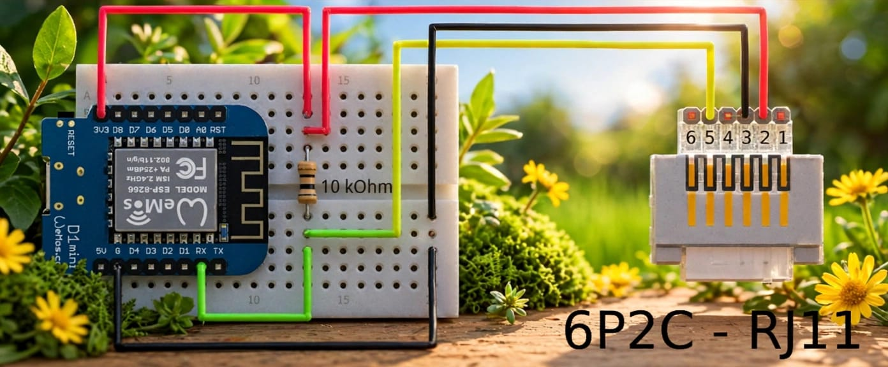
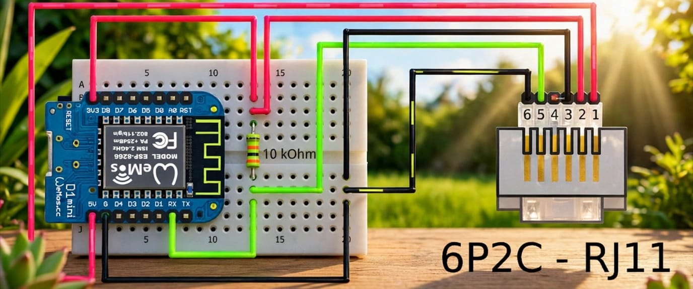

# ESPHome P1 Meter

ESPHome configuration for reading a DSMR-compatible electricity meter P1 port with a Wemos D1 mini (ESP8266). 
Every firmware variant exposes meter readings through the ESPHome native API and provides switches for MQTT control and reboot.

## Contents

- [Installation](#installation)
	- [Useful Terms](#useful-terms)
- [Supported Devices](#supported-devices)
- [Hardware and Wiring](#hardware-and-wiring)
	- [Check Your Meter First](#check-your-meter-first)
	- [P1 Wiring](#p1-wiring)
	- [Optional Meter Power](#optional-meter-power)
- [Firmware Options](#firmware-options)
- [Advanced Firmware Setup](#advanced-firmware-setup)
- [Home Assistant and MQTT](#home-assistant-and-mqtt)
- [Troubleshooting](#troubleshooting)
- [Safety and Security](#safety-and-security)
- [License](#license)

## Installation

Choose a guide to configure, compile, and install the software:

- [Install Released Version via web.esphome.io](docs/README-Install-Released-Version.md): <strong>Non-technical people start here.</strong> Install the released firmware (no compiling required).
- [ESPHome dashboard in Docker](docs/README-ESPHome-Dashboard-Dockered.md)  For those who prefer a browser-based ESPHome dashboard. Copy either YAML configuration into the dashboard; the advanced configuration's component is fetched automatically, so you do not need to download the project code. Use it for the Dashboard-Standard or Dashboard-Advanced configuration.
- [VS Code](docs/README-VSCode.md): build and flash the Public and Advanced firmwares with VS Code tasks or PlatformIO IDE, using a development container.

[Software Usage Guide](docs/README-Software-Usage-Guide.md): Instructions of how to use the software.

### Useful Terms

- **Configuration / YAML:** A text file containing the device settings. YAML is the format used for these files; the spaces at the start of lines matter.
- **DSMR:** A smart meter data standard, mostly used in the Netherlands. The meter sends readings in a format this firmware understands.
- **P1 port:** The data port on a smart meter, where the D1 mini connects with an RJ11 or RJ12 cable.
- **Firmware:** The software that runs on the D1 mini. **Compile** means build that software from a configuration; **flash** means install it on the device.
- **Firmware file (`firmware.bin`):** The file for the first installation over USB. **OTA file (`firmware.ota.bin`):** The file for later wireless updates; boards that publish only one file use `firmware.bin` for both.
- **OTA (over the air):** Updating the device over Wi-Fi instead of USB.
- **MQTT:** An optional way to send readings through a separate server called a broker. It is not needed to use the ESPHome integration in Home Assistant.
- **Secrets:** Private values such as Wi-Fi passwords, stored in `secrets.yaml` rather than directly in the configuration.
- **Terminal / PowerShell:** An application where you type commands. **Docker** runs the ESPHome dashboard in an isolated application called a container.

## Hardware and Wiring

- Wemos D1 mini (ESP8266)
- A 10 kΩ resistor
- A 4-contact RJ11 or 6-contact RJ12 cable and a compatible smart meter with its P1 port enabled
- A USB power supply, unless the meter can supply enough power through its P1 port

### Check Your Meter First

1. Confirm the meter is DSMR-compatible and its P1 port is enabled. Ask your energy supplier or meter operator if you are unsure; they may need to enable the port.
2. Find the P1 wiring diagram for your exact meter model and check that its pins match the table below. Wire colors and plug orientation can differ.

If anything is unclear, ask the meter operator, supplier, or a qualified technician before connecting. Do not guess from cable colors, and never connect to mains wiring.

### P1 Wiring

Verify the meter's P1 pinout and signal voltage before connecting: GPIO3 accepts 3.3 V logic, not 5 V. Use a suitable interface if your meter requires different signaling or voltage levels; the resistor alone does not make a 5 V signal safe.

| P1 pin | Signal | D1 mini connection |
| --- | --- | --- |
| 2 | RTS / data request | 3.3 V |
| 3 | Signal ground | GND |
| 4 | Not used | Not connected |
| 5 | Data | RX / GPIO3 |

Connect a 10 kΩ pull-up resistor between 3.3 V and the data line (P1 pin 5 / GPIO3). Many Landis+Gyr models require this resistor; some meters also accept 3.3 V on RTS, but requirements vary. With a 4-contact RJ11 plug, the outer contacts, P1 pins 1 and 6, are absent; the remaining contacts are pins 2 through 5. Check the actual cable's pinout, since wire colors and cable orientation can vary.

Power the D1 mini over USB for this wiring.

Show USB-powered wiring diagram

### Optional Meter Power

On compatible DSMR 5+ meters with a 6-contact cable, these additional connections can power the D1 mini instead of USB:

| P1 pin | Signal | D1 mini connection |
| --- | --- | --- |
| 1 | 5 V supply | 5V / VIN |
| 6 | Power ground | GND |

Keep the connections and pull-up resistor above. Before using meter power, verify that the meter supplies 5 V and enough current for the D1 mini, including Wi-Fi peaks.

Show meter-powered wiring diagram

 

Both configurations read inverted serial data on GPIO3 (`RX`) at 115200 baud, 8 data bits, no parity, and 1 stop bit. The D1 mini's UART transmit pin is not used.

## Supported Devices

- Wemos D1 mini (ESP8266): tested with the project; recommended
- NodeMCU v2 (ESP8266): compiles; not tested on hardware
- ESP32 DevKit (ESP32): compiles; not tested on hardware
- ESP32-S2 Saola-1 (ESP32-S2): compiles; not tested on hardware
- ESP32-S3 DevKitC-1 (ESP32-S3): compiles; not tested on hardware
- ESP32-C3 DevKitM-1 (ESP32-C3): compiles; not tested on hardware

The ESP32-C6 is not supported.

Show GPIO pin table

| Board | Chip | Status | Light (LED) GPIO | RX GPIO | RX GPIO (Alternative) |
| --- | --- | --- | --- | --- | --- |
| Wemos D1 mini | ESP8266 | Tested with the project; recommended | GPIO2 | GPIO3   GPIO3 is the ESP8266 UART0 RX pin. The ESPHome docs list GPIO3 as UART0 RX. | GPIO13 (D7)   ESPHome docs say hardware UART0 is RX GPIO13 with TX GPIO15. An RX-only config on GPIO13 may fall back to software UART, which is less accurate at 115200. GPIO15 is a boot pin, so it should not be used as TX. |
| NodeMCU v2 | ESP8266 | Compiles; not tested on hardware | GPIO2 | GPIO3   GPIO3 is the ESP8266 UART0 RX pin. The ESPHome docs list GPIO3 as UART0 RX. | GPIO13 (D7)   ESPHome docs say hardware UART0 is RX GPIO13 with TX GPIO15. An RX-only config on GPIO13 may fall back to software UART, which is less accurate at 115200. GPIO15 is a boot pin, so it should not be used as TX. |
| ESP32 DevKit | ESP32 | Compiles; not tested on hardware | GPIO2 | GPIO3   GPIO3 is the default UART0 RX (the USB serial console). That conflicts only if logging is on. | GPIO16   Default UART2 RX. Avoid it on modules with PSRAM (e.g. WROVER), which use GPIO16/17. Any GPIO can be routed through the matrix, so GPIO25 also works. |
| ESP32-S2 Saola-1 | ESP32-S2 | Compiles; not tested on hardware | GPIO18 (addressable LED) | GPIO3   Logger uses USB_CDC, so GPIO3 is free. | GPIO44   Default UART0 RX. The logger uses USB CDC, so it is free. Any unused GPIO also works via the matrix. Avoid GPIO26–32 on PSRAM modules. |
| ESP32-S3 DevKitC-1 | ESP32-S3 | Compiles; not tested on hardware | GPIO48 (addressable LED) | GPIO3   Logger uses USB_SERIAL_JTAG, so GPIO3 is free. Verify the GPIO3 strapping behavior on the ESP32-S3 before relying on it. | GPIO4, GPIO5, GPIO6 or GPIO7   Avoid GPIO43/44 on DevKitC-1 (UART bridge pins). Avoid GPIO19/20 (USB), GPIO3 (strapping), and GPIO26–37 (PSRAM/flash). |
| ESP32-C3 DevKitM-1 | ESP32-C3 | Compiles; not tested on hardware | GPIO8 (addressable LED) | GPIO3   Logger uses USB_SERIAL_JTAG. GPIO3 is a plain GPIO. | GPIO20   Default UART0 RX. The logger uses USB Serial/JTAG, so it is not claimed. GPIO4, GPIO5, GPIO6, GPIO7 and GPIO10 are also free. Avoid GPIO2, GPIO8 and GPIO9 (strapping), and GPIO12–17 (internal flash on some modules; verify for your module). |

## Firmware Options

- Public (released version)
- Advanced (VSCode/PlatformIO compile)
- Dashboard-Standard (ESPHome Dashboard, file `p1meter_wemosd1mini_noWebUI.yaml`)
- Dashboard-Advanced (ESPHome Dashboard, file `p1meter_wemosd1mini_withWebUI.yaml`)

Show firmware variants table

| Variant | Install with | Web interface | Encrypted API | OTA updates | Use when |
| --- | --- | --- | --- | --- | --- |
| Public (`firmwares/public`) | ESPHome Web (Download `.bin` from `releases`), VS Code or PlatformIO | Yes (setup password on first run) | No | Web interface only | You want the quickest start on a trusted network. |
| Advanced (`firmwares/advanced`) | VS Code or PlatformIO (using your own keys) | Yes | Yes | ESPHome API and web interface | You compile yourself with your own encryption key and OTA password. |
| Dashboard-Standard (`p1meter_wemosd1mini_noWebUI.yaml`) | ESPHome Dashboard | No | Yes | ESPHome API | You install from the ESPHome Dashboard and can only modify Wi-Fi and MQTT via the ESPHome Dashboard. |
| Dashboard-Advanced (`p1meter_wemosd1mini_withWebUI.yaml`) | ESPHome Dashboard | Yes | Yes | ESPHome API and web interface | You install from the Dashboard and can modify Wi-Fi and MQTT anytime via the web interface. |

 

All variants expose the following configured DSMR sensor set:
- Imported and exported energy for tariffs 1 and 2
- Total imported and exported power
- Imported power, current, and voltage per phase
- Gas consumption
- Short and long power-outage counts
- Voltage-drop and voltage-peak counts on phase 1
- Meter identification, P1 version, and active tariff group

A meter only reports values supported by its telegram, so some entities may remain unavailable.

Notes: 
- Public variant supports OTA only through its web interface. 
- Dashboard-Standard supports ESPHome OTA only. 
- Advanced and Dashboard-Advanced variants support ESPHome OTA and browser-based OTA through the web interface. (ESPHome OTA is protected by `p1meter__ota_password` from `secrets.yaml`)

## Advanced Firmware Setup

The `P1-Meter-Setup` Wi-Fi access point and web interface of the Advanced and Dashboard-Advanced variants let you configure Wi-Fi and MQTT and update firmware. The Public variant has the same setup network with the public password `p1meter-setup` until you change it; see the [Software Usage Guide](docs/README-Software-Usage-Guide.md#first-setup-in-the-web-interface).

The access point starts immediately if no Wi-Fi is saved, or after 90 seconds if the device fails to connect.

Connect with `p1_meter__setup_wifi_password`, then open `http://192.168.4.1/`. 
If prompted by the browser, sign in with username `p1meter` and the same password.

The sign-in notification does not appear reliably on every phone.  
While connected to `P1-Meter-Setup`, always open `http://192.168.4.1/` in a browser.

The home page offers:

- **Configure:** Choose a nearby Wi-Fi network or enter its name and password. MQTT is optional. Choose DHCP or enter a static IP, gateway, and subnet, then save and reboot. DNS is optional. Disabling MQTT clears its saved credentials.
- **OTA Update:** Upload ESPHome's `firmware.ota.bin`. The device reboots after the update succeeds.
- **Factory Reset:** Erase saved settings and reboot. The setup access point starts immediately.
- **Reboot:** Confirm to reboot immediately.

Use the top-right sign-out button to end the session. It tries to close the tab; if the browser blocks it, a signed-out message appears.

Warning: 
Anyone connected to the password-protected web interface can view saved Wi-Fi and MQTT passwords, configure, update, reboot, or reset the device. 
Keep its password private. The web interface uses unencrypted HTTP, so use it only on a trusted network.

With the Advanced and Dashboard-Advanced variants, the device keeps trying to reconnect to your saved Wi-Fi while the `P1-Meter-Setup` access point is on. Once it reconnects, the setup access point turns off automatically. 

Note:
You can access the web interface by opening `http://<device-ip-address>` or whether mDNS supported [http://ip-meter.local](http://ip-meter.local).

## Home Assistant - ESPHome API and MQTT

Add or accept the discovered `p1-meter` node in Home Assistant's ESPHome integration. The native API is enabled in both configurations and has a 30-minute reboot timeout if the API client remains disconnected.

- You can use the **MQTT** switch to enable or disable the client
- You can use the **Reboot** switch to reboot the device.

## Troubleshooting

- **Configuration validation fails:** Check YAML indentation, `secrets.yaml` presence and key names, and that the installed ESPHome version supports the configured components.
- **Cannot flash over USB:** Try a known data cable and another USB port, confirm the serial device name and permissions, and close serial monitors or other programs using the port.
- **Device does not join Wi-Fi:** Verify the SSID and password, 2.4 GHz Wi-Fi availability for the ESP8266, and router client isolation settings.
- **Dashboard shows the device as offline:** Check that mDNS multicast traffic on UDP port 5353 can reach the Dashboard. On Linux, run the Dashboard with host networking as described in the [Dashboard guide](docs/README-ESPHome-Dashboard-Dockered.md#start-the-dashboard). The Dashboard and device should be on the same network; separate VLANs or subnets need an mDNS reflector and appropriate firewall rules. This allows discovery with either DHCP or a static IP, without `use_address`.
- **No meter values:** Confirm the meter's P1 port is enabled, the interface wiring and signal levels are correct, the interface output reaches GPIO3, and the meter's telegram baud rate and format match the configuration. Check logs with `esphome logs p1meter_wemosd1mini_noWebUI.yaml` or `esphome logs p1meter_wemosd1mini_withWebUI.yaml`.
- **MQTT does not connect:** Verify that MQTT is enabled, then check broker address, port/reachability, username, password, and broker logs.
- **OTA cannot find the node:** Check that the computer and device can communicate on the LAN, then specify its current IP or hostname. For the standard configuration, `wifi.use_address` can also be set. Use USB flashing if network connectivity has not been established.

The onboard LED on GPIO2 stays on while Wi-Fi is connected. The standard firmware blinks it once per second while disconnected; the advanced firmware blinks it every 250 ms while its setup AP is active, otherwise once per second while disconnected.

## Safety and Security

Keep `secrets.yaml` private. Do not commit Wi-Fi or broker credentials. If credentials have been exposed, rotate them. Verify the meter's P1 wiring and voltage levels; use a compatible interface where needed. Incorrect wiring or voltage levels can damage the meter or the D1 mini.

## License

Unless otherwise noted, original project code and documentation are licensed under the [PolyForm Noncommercial License 1.0.0](LICENSE). Third-party material is not relicensed by this file and remains subject to its own terms and notices.